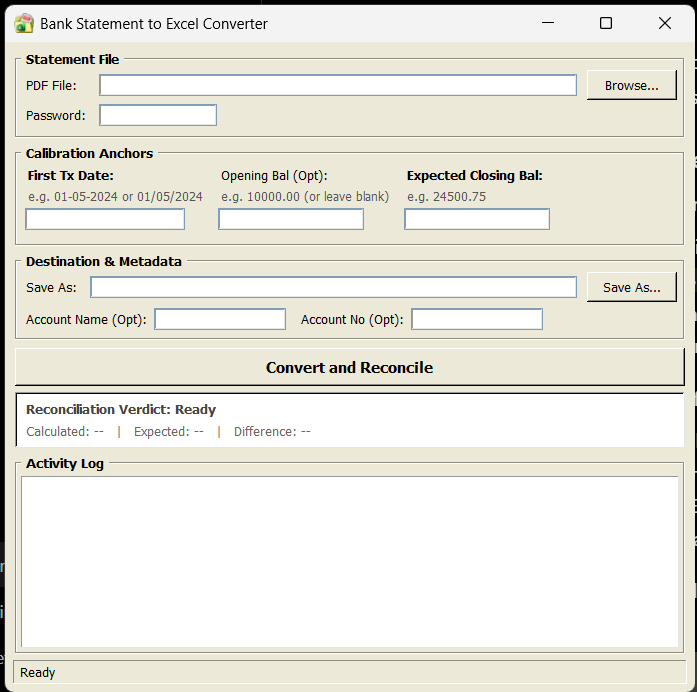
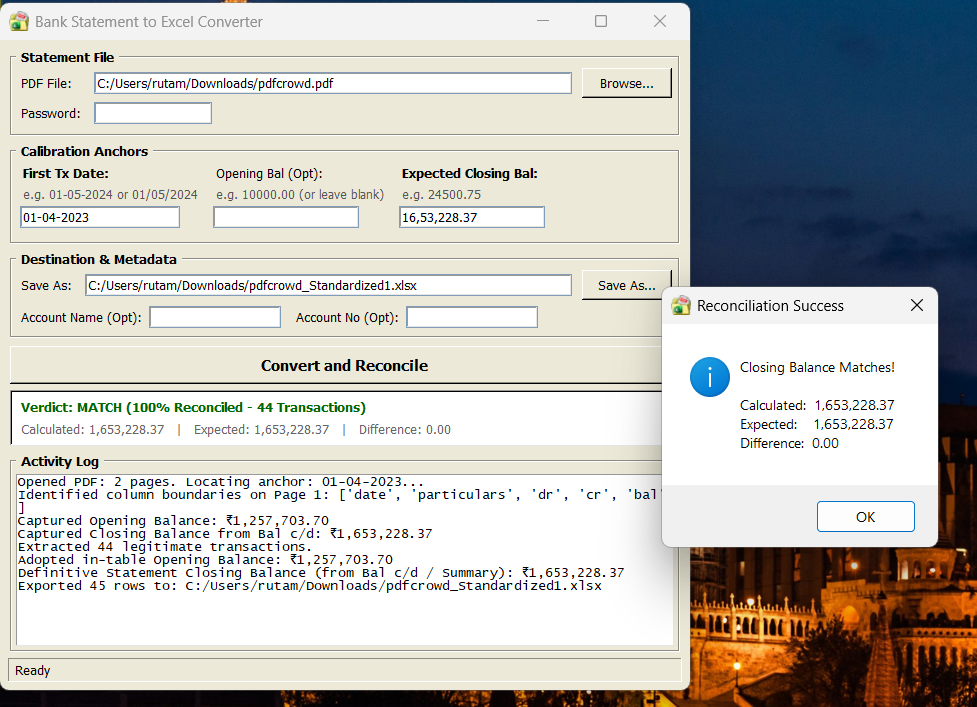
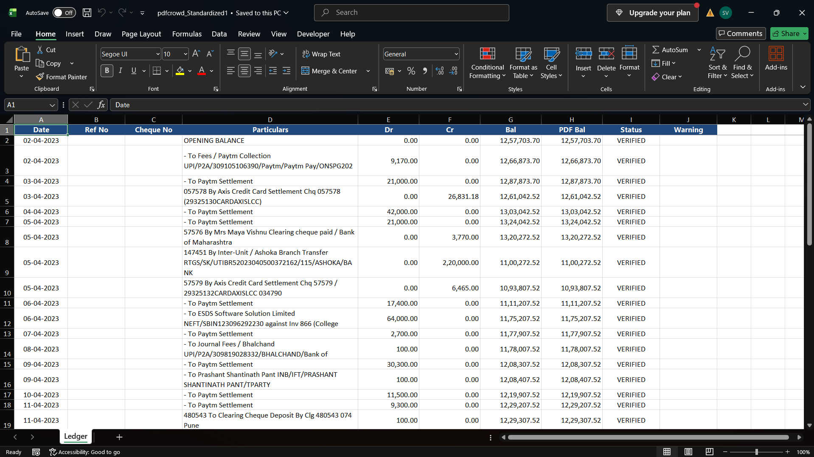

# Bank Statement to Excel Converter

A lightweight Windows desktop application that converts bank statement PDFs into structured, standardized Excel workbooks (`.xlsx`) with balance verification and Excel formulas.

Built with a classic Windows XP Luna-inspired interface (`#ECE9D8`), the application aims to provide fast startup, clear display on high-DPI screens, and accurate balance checks against the original bank statement.

> **Development Note:** This application was built through **vibecoding with AI assistance**. AI helped with code generation, parsing logic, debugging, handling different PDF layouts, and designing the desktop interface.

---

## Features

- **PDF Balance Comparison:** Uses the running balances printed in the bank statement as a reference for checking extracted transactions and identifying discrepancies.
- **Excel Formulas:** Generates formulas for running balances, verification checks, discrepancy warnings, and debit/credit totals.
- **Multiple Date Formats:** Attempts to recognize different date formats used in Indian and international bank statements, such as `16 Jun 19`, `16 Jun 2019`, `Jun 16, 2019`, `16/06/2019`, and `2019-06-16`.
- **Balancing Figure & Noise Detection:** Attempts to identify non-transactional entries such as `By Balance c/d`, `To Balance c/f`, `TOTAL`, and `STATEMENT SUMMARY`, as well as unrelated text appearing after transactions.
- **Amount Recovery:** Where supported by the extracted data, uses changes between consecutive balances to help identify missing debit or credit amounts.
- **Conversion History:** Keeps a history of previous conversions, including timestamps, statuses, and transaction counts. Double-clicking a record can open the workbook or its containing folder.
- **Clear Form:** Resets the form inputs, logs, and status indicators.
- **Windows Installer:** Supports packaging the application with PyInstaller and Inno Setup for easier installation on Windows.

---

## How It Works

1. **Select Statement PDF:** Choose the bank statement PDF and enter its password if required.
2. **Enter First Transaction Date:** Provide the first transaction date, such as `16/06/2019` or `16 Jun 19`, to help the application locate the transaction table.
3. **Enter Balances (Optional):** Provide the opening balance or expected closing balance if known. The application may also identify balance information from the statement itself.
4. **Convert and Check:** The application extracts transaction information, checks the balances using its implemented verification logic, and creates the Excel workbook.
5. **Review the Results:** Check the verification status in the application or open the generated workbook to inspect the extracted data and formulas.

---
## Core Architecture & Reconciliation Logic

The converter uses a deterministic, audit-first pipeline to transform unstructured, borderless bank statement PDFs into structured Excel ledgers with formula-based balance verification. The objective is to preserve extracted transaction data, handle inconsistent PDF layouts, and minimize cumulative rounding errors.

1. **Multi-Token Sliding-Window Date Parsing**

Traditional regex parsers can fail when banks render dates as separate text tokens across horizontal coordinates (e.g., "16 Jun 19").

- Sliding-Window Detection: Evaluates dynamic token spans of 3, 2, and 1 tokens to identify dates split across PDF text elements.
- Supported Date Formats:
  - Alphanumeric: "DD Mon YY", "DD Month YYYY", "Mon DD, YYYY"
  - Numeric: "DD/MM/YYYY", "DD-MM-YYYY", "DD.MM.YY"
  - ISO-style: "YYYY-MM-DD", "YYYY/MM/DD"
  - Space-separated: "DD MM YYYY"
- Token Isolation: Identified date tokens are removed from the remaining description stream to prevent dates from leaking into transaction particulars.

2. **Continuation-Line Fusion & Phantom Row Elimination**

Bank statements often wrap transaction descriptions and numerical values across multiple PDF text lines without repeating the transaction date.

- Anchor Locking: A new transaction record is created only when a valid transaction date is detected.
- Continuation Fusion: Lines without a valid transaction date are treated as continuations of the active transaction.
- Description Reconstruction: Continuation text is appended to "particulars_parts" in the order it appears.
- Numeric Field Recovery: Wrapped or trailing numerical values are merged into the active transaction's missing fields instead of creating separate zero-balance or phantom rows.

3. **Delta-Balance Movement Authority ("Δ PDF Bal")**

The engine uses the bank's printed running balance as an independent reference for validating transaction amounts and identifying column misalignment.

For consecutive valid transactions:

"Δ PDF Bal = Current PDF Balance - Previous PDF Balance"

- Column Drift Correction: When the absolute balance movement matches the maximum of the extracted debit and credit amounts, the sign of the balance movement determines the likely transaction direction:
  - Negative delta → Debit ("Dr")
  - Positive delta → Credit ("Cr")
- Missing Amount Recovery: If both extracted debit and credit amounts are zero, the transaction magnitude and direction can be recovered from the balance movement.
- Extracted Value Precedence: If the extracted amount conflicts with the balance movement, the original extracted amount is preserved. The row is marked "DIFF", and the variance is recorded in the warning column rather than silently overwriting the source value.

4. **Global Statistical Account Classification**

Savings and current accounts generally follow standard balance movement, while overdraft (OD) and cash credit (CC) accounts follow the opposite relationship.

Instead of classifying an account based on a single transaction, the engine evaluates consecutive transaction pairs across the statement.

- Majority-Vote Consensus: An account is classified as OD/CC only when at least three verified transitions are available and the number of OD-consistent matches exceeds the number of standard-account matches.
- Outlier Resistance: Isolated reversals, bank adjustments, and unusual transactions are less likely to cause incorrect classification of the entire statement.
- Consistent Balance Logic: The resulting account classification determines the running-balance formula used in the exported workbook.

5. **Dynamic Formula Injection & Live Auditability**

The exported Excel workbook is generated using "openpyxl" and includes live formulas instead of relying exclusively on static calculated values.

Running Balance — Column G

For standard accounts:

`=G{r-1}-E{r}+F{r}`

For OD/CC accounts:

`=G{r-1}+E{r}-F{r}`

PDF Balance — Column H

Stores the extracted running balance from the source PDF as a fixed reference for verification.

Audit Status — Column I

`=IF(OR(H{r}="",H{r}=0),"VERIFIED",IF(ROUND(ABS(G{r}-H{r}),2)<=0.05,"VERIFIED","DIFF"))`

The formula compares the calculated running balance against the extracted PDF balance, allowing a tolerance of "0.05".

Discrepancy Warning — Column J

`=IF(I{r}="DIFF","Math diff: "&TEXT(G{r}-H{r},"#,##0.00"),"")`
When a row is marked "DIFF", the warning column displays the difference between the calculated and extracted balances.

Summary & Accounting Double-Underline
- Debit and credit totals are calculated dynamically using "SUM" formulas.
- The final running balance is linked to the last transaction row.
- Changes to debit or credit values automatically propagate through subsequent running balances and audit checks.
- Accounting-style double underlining is applied to relevant summary totals.
This structure provides a transparent audit trail in which extracted balances remain available for independent comparison against formula-calculated balances.

## Excel Output & Audit Columns

The exported workbook is designed to use the following structure:

| Column | Header | Type | Description |
|---|---|---|---|
| A | `Date` | Date (`DD-MM-YYYY`) | Transaction date |
| B | `Ref No` | Text | Bank transaction reference number |
| C | `Cheque No` | Text | Cheque number, where available |
| D | `Particulars` | Text | Transaction description |
| E | `Dr` | Number (`#,##0.00`) | Withdrawal or debit amount |
| F | `Cr` | Number (`#,##0.00`) | Deposit or credit amount |
| G | `Bal` | Formula | Running balance calculated by Excel |
| H | `PDF Bal` | Number (`#,##0.00`) | Balance extracted from the PDF |
| I | `Status` | Formula | Verification result, such as `VERIFIED` or `DIFF` |
| J | `Warning` | Formula | Indicates a detected discrepancy |

The actual output depends on the data successfully extracted from the source PDF. Always compare the results with the original statement.

---

## Built With

- **Python 3.10+** — Main application
- **Tkinter & ttk** — Desktop interface
- **pdfplumber** — Extracting text and positional information from PDFs
- **pandas** — Organizing transaction data
- **openpyxl** — Creating and formatting Excel workbooks
- **Pillow (PIL)** — Image and icon processing
- **PyInstaller** — Packaging the application
- **Inno Setup** — Creating the Windows installer

---

## Installation & Setup

### Option 1: Windows Installer

If a release is available, download it from the [Releases page](https://github.com/Batatatab/bank-statement-converter/releases).

1. Download `BankStatementConverter_Setup.exe`.
2. Run the installer.
3. Choose whether to create a desktop shortcut, if offered.
4. Launch the application.

*Note: The installer must be published on the Releases page before it can be downloaded this way.*

### Option 2: Run from Source

**1. Clone the repository**

```bash
git clone https://github.com/Batatatab/bank-statement-converter.git
cd bank-statement-converter
```

**2. Create and activate a virtual environment**

```powershell
python -m venv venv
.\venv\Scripts\activate
```

**3. Install dependencies**

```bash
pip install -r requirements.txt
```

**4. Run the application**

```bash
python app_gui.py
```

---

## Building the Installer from Source

These steps assume that the required files and tools are present in the repository.

**1. Build the application with PyInstaller**

```powershell
pyinstaller --noconsole --onedir --clean --icon=app_icon.ico --add-data "app_icon.ico;." --name "BankStatementConverter" app_gui.py
```

**2. Compile the installer with Inno Setup**

```powershell
& "C:\Program Files (x86)\Inno Setup 6\ISCC.exe" "installer.iss"
```

The installer output location depends on the configuration in `installer.iss`. For example, it may be generated at:

```text
dist_installer/BankStatementConverter_Setup.exe
```

---

## Screenshots

### Main Application


### Conversion Process


### Standardized Excel Output


---

## AI-Assisted Development

This is an open-source, **vibecoded project**. AI tools were used extensively to help build the application, write and understand code, troubleshoot errors, and improve the interface.

I'm learning programming while working on this project. The tool is still evolving, and there is more work to do, particularly in handling different bank statement layouts and improving extraction accuracy.

Suggestions, bug reports, and contributions are welcome.

---

## Disclaimer

1. **Not Professional Advice:** This application is an independent utility intended to assist with document processing. It does not provide financial, accounting, legal, tax, or statutory audit advice.
2. **Verify the Results:** PDF extraction can be affected by document quality, scanned pages, font encoding, and changes in layout. Always cross-check extracted dates, amounts, and balances against the original bank statement before using the results for bookkeeping, tax filings, GST returns, or audits.
3. **No Bank Affiliation:** This project is not endorsed by, affiliated with, or sponsored by any bank or financial institution. All referenced trademarks belong to their respective owners.
4. **Software Provided As-Is:** This software is distributed under the MIT License, without warranties or guarantees. The authors and contributors are not responsible for losses or inaccuracies arising from its use.

---

## License

Distributed under the MIT License. See [`LICENSE`](LICENSE) for details.
